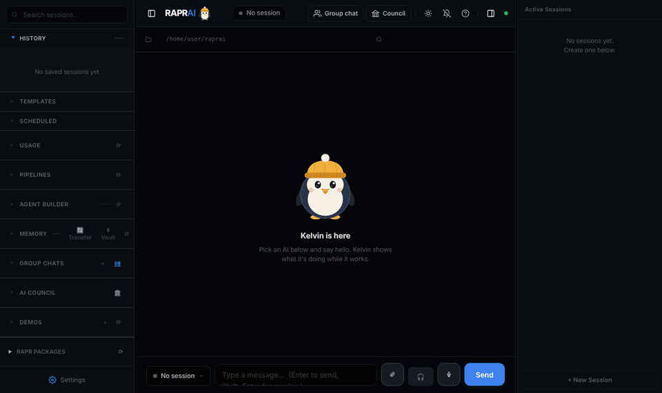

<div align="center">


# RAPR AI

**Run Claude Code, Codex, Antigravity, Ollama and more side by side, let them work together in group chats, and control them from your browser, Telegram or WhatsApp.**

[](release-notes/)
[](LICENSE)

[](https://github.com/hashgraph-online/awesome-ai-plugins#tools--integrations)
[](https://hol.org/registry/plugins/rawalrahul%2Fraprai)
[](https://github.com/rawalrahul/raprai/stargazers)

[Website](https://raprai.com) · [Install](#install) · [Features](#what-you-can-do) · [Full guide](docs/guide.md) · [Contributing](CONTRIBUTING.md)



<sub>A group chat: Claude builds it, Antigravity reviews it, Codex updates the tests. (Demo recorded with scripted replies.)</sub>

</div>

---

## Why RAPR AI

You probably already pay for one or two AI coding agents, and each lives in its own terminal. RAPR AI puts them all in one place:

- **Use them together, not one at a time.** Put Claude Code, Codex and Antigravity in one group chat. Ask once; they answer, review each other's work and hand off with `@mentions`.
- **Leave your desk.** Every session is reachable from your phone through Telegram or WhatsApp, and you get a notification when an AI needs your approval.
- **Bring the AIs you already have.** RAPR runs the official command-line tools with your own sign-ins, so your existing plans and limits just work. There's nothing to sign up for.
- **Free and open source** under the MIT license. Everything runs on your computer (or your own server).

## What you can do

| | |
|---|---|
| 💬 **Group chats** | Several AIs in one conversation. `@mention` who should answer, or `@all`. Ready-made **crews** give each AI a job: code review, research, launch, debate. |
| 🧪 **Bake-off** | Give the same task to several AIs. Each works in its own copy of your project; compare the diffs, test results and time, then merge the winner. Share the result as a card, or publish it to the public [RAPR Arena](https://www.raprai.com/arena) leaderboard. |
| 🔌 **Second opinions from your editor** | RAPR is an MCP server: from Claude Code, Codex or Cursor, ask another AI to review your changes, answer a question or join a bake-off. Runs on your computer; your files stay untouched unless you allow edits. [Set it up](#use-rapr-inside-claude-code-or-codex) |
| 🐧 **Monthly recap** | Your month as a shareable card: your AI crew and its MVP, streaks, bake-offs, and what running AIs locally saved you. Worked out on your computer. |
| 🧭 **Smart routing** | Choose "Auto" and RAPR picks the AI for each task: free local models for easy work, the strongest coding agent for hard work, skipping any AI that's over budget. |
| 📱 **Phone control** | Telegram bot and WhatsApp (scan a QR code, no Business API). Start sessions, send tasks, approve actions, get files back. |
| 🖥️ **Parallel sessions** | Many sessions at once, each with its own AI, folder and history. Resume any past conversation. |
| 🛡️ **Your rules** | Decide what always needs a yes, what is never allowed and what can run on its own. Every decision is logged. |
| 🧠 **Shared memory & playbooks** | What one AI learns is available to the others. RAPR keeps how-to notes from past tasks. |
| ☁️ **Your own server** | One command installs RAPR on any Linux server (Oracle's free tier works) with a free public address, so it runs while your laptop is off. |

## Works with

**Coding agents** (they use your own sign-in): Claude Code · Codex · Antigravity · Copilot CLI · Cursor · OpenCode · Droid · Qwen Code · Kiro (Amazon Q) · Aider · Goose · Kilo Code · OpenClaw · Open Interpreter

**Free and local:** Claude Code and Codex on a local model through Ollama, plus Ollama on its own

**Models through an API key:** Groq · OpenRouter · GitHub Models · LM Studio and any OpenAI-compatible server

**Anything else:** add any agent that speaks the [Agent Client Protocol](https://agentclientprotocol.com) in Settings → Agents over ACP, or any command-line AI in Settings → AI Integrations.

**Any app with an MCP server:** click **+ Add MCP server** in RAPR Packages, paste its URL (or command, or the JSON snippet from its docs) and sign in. Every AI in RAPR can then use its tools.

Install the tools you want, and RAPR finds them. **Settings → AI Integrations** lists every supported AI with its install command.

## Install

One command on each platform. It installs the latest version, and the same command updates it later.

**Windows 10/11** (in PowerShell):
```powershell
irm https://raw.githubusercontent.com/rawalrahul/raprai/main/scripts/install-windows.ps1 | iex
```
Adds **RAPR AI** to your Start menu and desktop, plus a `rapr` command. Python 3.12 is installed for you if it's missing.

**macOS 12+** (in Terminal):
```bash
curl -fsSL https://raw.githubusercontent.com/rawalrahul/raprai/main/scripts/install-mac.sh | bash
```
Adds a **RAPR AI** app to your Applications, plus a `rapr` command.

**Linux server** (Ubuntu/Debian, x86 or ARM, over SSH):
```bash
curl -fsSL https://raw.githubusercontent.com/rawalrahul/raprai/main/scripts/install-server.sh | bash
```
RAPR runs in Docker and prints a free public address to open. See [docs/cloud-setup.md](docs/cloud-setup.md).

On first launch, a short setup page asks for a PIN and, optionally, a Telegram bot. Then pick an AI and start a session.

### Update and uninstall

| | Windows / macOS | Linux server |
|---|---|---|
| **Update** | **Settings → Updates → Update now**, or `rapr update` (or run the install command again) | `rapr update` |
| **Uninstall** | `rapr uninstall`: type `yes` to keep your chats and settings, `all` to delete them | `rapr remove` |
| **Start / stop** | `rapr start` / `rapr stop` (or the RAPR AI app) | `rapr restart` |
| **Status and logs** | `rapr status`, `rapr logs` | `rapr status`, `rapr logs`, `rapr url` |

**How RAPR knows about updates:** every hour it asks GitHub whether the branch it was installed from (`main` by default) has new commits. That's an ordinary web request carrying RAPR's version number; nothing else is sent. When there's something new, a dot appears on Settings, and **Settings → Updates** lists what changed. Offline, the check just skips. Turn it off in the same place (or set `UPDATE_CHECK=0` in `.env`); **Check now** still works.

Your chats and settings live in `%LOCALAPPDATA%\RAPR AI` (Windows) or `~/Library/Application Support/RAPR AI` (Mac), so updating keeps them. Used the old Windows `.exe` installer? Run the Windows command: it uses the same folder, so everything carries over. Then remove the old app in Windows Settings → Apps.

**From source:** see the [full guide](docs/guide.md#prerequisites).

## Use RAPR inside Claude Code or Codex

RAPR is an MCP server, so the AI you're already coding with can ask the others for help. After installing RAPR, add it once:

```bash
claude mcp add --scope user rapr -- rapr mcp     # Claude Code
codex mcp add rapr -- rapr mcp                   # Codex
```

On Windows, end both with `-- cmd /c rapr mcp`. For Codex, also add `tool_timeout_sec = 600` under `[mcp_servers.rapr]` in `~/.codex/config.toml`: Codex gives up on a tool after 60 seconds, and a review usually takes a few minutes. Cursor, Windsurf and other clients: add a server with the command `rapr` and the argument `mcp`.

Then ask in plain words: *"get a second opinion from Codex on my changes"*, *"ask Claude how it would structure this"*, *"run a bake-off between Claude and Codex on this task, with pytest -q"*.

| Tool | What it does |
|---|---|
| `second_opinion` | Another AI reviews your uncommitted changes (or the last commit, or changes since a branch you name) and reports bugs, most serious first. |
| `ask_agent` | Puts any question or task to another AI and returns its reply. |
| `start_bakeoff`, `bakeoff_status`, `merge_bakeoff`, `discard_bakeoff` | A bake-off from your editor: 2 to 4 AIs, each in its own copy of the project; merge the one you like. |
| `list_agents` | The AIs installed and signed in on this computer. |

The other AI works in a temporary copy of your project, so your files only change if you allow edits or merge a bake-off. Nothing is hosted and the RAPR app doesn't need to be open. More in the [full guide](docs/guide.md#use-rapr-from-claude-code-cursor-or-codex-mcp).

## How it works

```
 Browser  ─┐                                     ┌─ Claude Code  (~/projects/web)
 Telegram ─┼─▶  RAPR AI  (one Python process) ──┼─ Codex        (~/projects/web)
 WhatsApp ─┘    sessions · group chats · rules   ├─ Antigravity  (~/projects/api)
                                                 └─ Ollama       (offline)
```

RAPR starts each AI's own command-line tool in the folder you choose and streams its replies to every channel. Your chats, settings and keys stay in RAPR's data folder on your machine; keys are encrypted.

## Documentation

- [Full guide](docs/guide.md): Telegram setup, every command, sessions, history, files, memory, packages and backups
- [Run it on your own server](docs/cloud-setup.md)
- [Release notes](release-notes/)

## Contributing

Ideas, bug reports and pull requests are welcome. See [CONTRIBUTING.md](CONTRIBUTING.md), and look for issues labelled **good first issue**. If RAPR AI is useful to you, a ⭐ helps other people find it.

## License

[MIT](LICENSE): use it, fork it, build on it.
